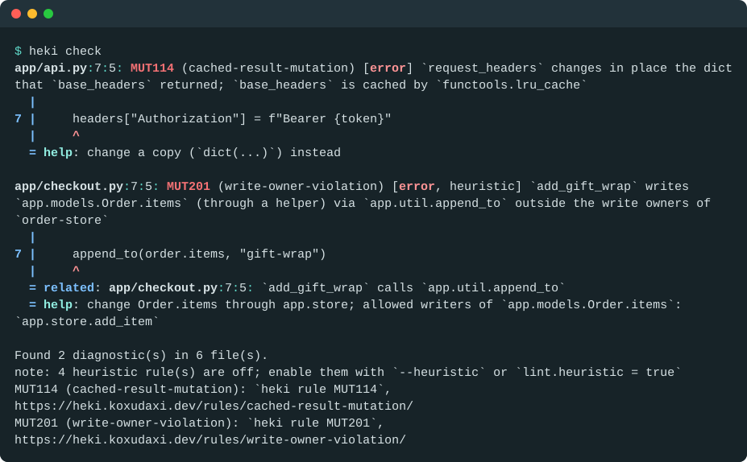

# heki

<p align="center">
  
</p>

🧱 heki (壁, Japanese for "wall") is a static checker for Python, written in Rust. It tracks side
effects and mutations across function calls, and checks a 100,000-line project in a few seconds.

Ruff checks syntax and style, and ty, mypy, and Pyright check types. heki checks what your code
does: which effects a call reaches and which state it changes, across functions and files.

Out of the box, it catches blocking calls in `async` code, database queries in loops, quadratic
loops, and in-place changes to read-only parameters and to `lru_cache` results. You can also
write your project's own rules as [contracts](https://heki.koxudaxi.dev/configuration/#contracts),
such as which functions may change a field or reach I/O.



📚 [Documentation](https://heki.koxudaxi.dev/) ·
🚀 [Getting started](https://heki.koxudaxi.dev/getting-started/) ·
📏 [Rules](https://heki.koxudaxi.dev/rules/)

[](https://pypi.org/project/heki/)
[](https://pypi.org/project/heki/)
[](https://github.com/koxudaxi/heki/actions/workflows/ci.yml)
[](https://github.com/koxudaxi/heki/blob/main/LICENSE)

⚡ Try it in your project's root, without installing: `uvx heki==0.9.0 check`. Then follow
[Try it in 5 minutes](#try-it-in-5-minutes).

---

### A blocking call two helpers below an `async def`

```python
# app/users.py
import requests

def fetch_name(user_id: int) -> str:
    return requests.get(f"https://api.example.com/users/{user_id}", timeout=5).text

def load_user(user_id: int) -> dict[str, str]:
    return {"id": str(user_id), "name": fetch_name(user_id)}
```

```python
# app/api.py
from app.users import load_user

async def get_user(user_id: int) -> dict[str, str]:
    return load_user(user_id)
```

```console
$ heki check
app/api.py:5:12: EFF101 (async-blocking-call) [error] `app.users.load_user` always runs the waiting call `requests.get` on the event loop (2 calls down, on every path)
  |
5 |     return load_user(user_id)
  |            ^
  = related: app/api.py:5:12: `get_user` calls `app.users.load_user`
  = related: app/users.py:8:41: `load_user` calls `app.users.fetch_name`
  = related: app/users.py:5:12: `fetch_name` calls `requests.get`
  = help: offload it with `asyncio.to_thread`, or use an async client

Found 1 diagnostic(s) in 2 file(s).
note: 4 heuristic rule(s) are off; enable them with `--heuristic` or `lint.heuristic = true`
EFF101 (async-blocking-call): `heki rule EFF101`, https://heki.koxudaxi.dev/rules/async-blocking-call/
```

### A query one helper below a loop

```python
# app/orders.py
import sqlite3

def customer_name(cursor: sqlite3.Cursor, customer_id: int) -> str:
    cursor.execute("SELECT name FROM customers WHERE id = ?", (customer_id,))
    return str(cursor.fetchone()[0])

def order_summaries(cursor: sqlite3.Cursor, orders: list[tuple[int, int]]) -> list[str]:
    lines: list[str] = []
    for order_id, customer_id in orders:
        lines.append(f"#{order_id} {customer_name(cursor, customer_id)}")
    return lines
```

```console
$ heki check
app/orders.py:11:37: EFF103 (loop-db-query) [warning] every iteration over parameter `orders` sends a database statement: `sqlite3.Cursor.execute` (through `app.orders.customer_name`)
   |
11 |         lines.append(f"#{order_id} {customer_name(cursor, customer_id)}")
   |                                     ^
  = related: app/orders.py:11:37: `order_summaries` calls `app.orders.customer_name`
  = related: app/orders.py:5:5: `customer_name` calls `sqlite3.Cursor.execute`
  = help: batch the queries, or load the data once before the loop

Found 1 diagnostic(s) in 1 file(s).
heki check does not fail on 1 report(s) shown now: warnings, and heuristic reports, which can be wrong about the code and count as warnings; `fail-on = "warning"` in the lint settings makes them fail it.
note: 4 heuristic rule(s) are off; enable them with `--heuristic` or `lint.heuristic = true`
EFF103 (loop-db-query): `heki rule EFF103`, https://heki.koxudaxi.dev/rules/loop-db-query/
```

Ruff, ty, Pyrefly, pyright, and mypy report nothing for either example with their default settings.
Strict settings don't help either: the second example is fully annotated and passes Ruff's `ANN`
rules, `mypy --strict`, pyright's strict mode, and Pyrefly's `strict` preset. It still sends one
query per order.

### How heki differs

| Tool | Models | heki adds |
| --- | --- | --- |
| Ruff | syntax and style | the effects behind a call: a blocking call, a query, or a write, wherever it happens |
| ty, Pyrefly, pyright, mypy | declared types | in-place changes, through aliases and helpers, to `frozen`, `ReadOnly`, and `Final` fields and to `Sequence` / `Mapping` / `AbstractSet` arguments |
| tach, import-linter | which modules may import which | which functions write or read a field, call a function, or reach I/O; import rules that know when each import runs (experimental); planned: reading these tools' contracts as heki contracts |

heki leaves syntax, style, and types to these tools, so use it next to them. Its configuration,
suppression comments, and output formats follow Ruff's.
[What Python leaves open](https://heki.koxudaxi.dev/#what-python-leaves-open) compares its checks
with what Rust and Haskell enforce.

### Installation

```console
$ uv tool install heki      # or: pipx install heki / pip install heki
$ uvx heki check            # run without installing
```

### Try it in 5 minutes

1. In your project's root (the directory with `pyproject.toml`), run `uvx heki==0.9.0 check`. An
   exact error, like the first example above, fails the run (exit code 1). Warnings, like the
   second, are printed but don't fail it unless you pass `--fail-on warning`.

2. Ask what fits the project with [`heki recommend`](https://heki.koxudaxi.dev/recommend/)
   (experimental). It writes no file, and it helps most when the first step finds nothing, as on
   the [sample service](https://github.com/koxudaxi/heki/tree/main/tests/sample_service) in
   heki's tests:

    ```console
    $ uvx heki==0.9.0 check
    All checks passed (4 file(s)).
    ...
    hint: `heki recommend` (experimental) lists the rules and contracts that fit this project, and what heki could not see
    $ uvx heki==0.9.0 recommend
    heki recommend (experimental) on .: 4 file(s), 10 function(s)
    ...
    What heki cannot see (no report either way)
      calls of packages heki's catalog does not cover: 1 call(s) of 1 name(s) in 1 package(s)
        name                  calls  async  loops  if it waits     if it sends a query
        stripe.Charge.create      1      1      0  EFF101 1 exact  -
    ...
    Contract candidates
      write-owners  app.models:Order.*  high
        written by 1 function(s), all in app.store (add_item), changed in place; read in 2 other module(s)
    ...
    ```

    heki's catalog doesn't say what `stripe.Charge.create` does, so heki reports nothing through
    it. If the call waits on the network, `EFF101` would report it in `async def checkout`. Only
    `app.store` writes `Order.items`, so the report ends with the keys that make that a contract.

3. Keep it running with the [pre-commit hook](https://heki.koxudaxi.dev/adoption/#pre-commit) and
   a CI step. If the project has findings today, record them in a
   [Ratchet baseline](https://heki.koxudaxi.dev/adoption/#ratchet-baselines) so only new ones
   fail: `uvx heki==0.9.0 check --baseline heki-baseline.toml --update-baseline`, then
   `baseline = "heki-baseline.toml"` in `[tool.heki]`. The
   [starter recipes](https://heki.koxudaxi.dev/adoption/#starter-recipes) have these setups ready
   to copy.

> [!WARNING]
> 🧪 **Pre-release.** Rules, configuration keys, diagnostics, and output formats can change
> between releases without a deprecation period, and the release notes list every change. Pin the
> version (`heki==0.9.0`, and the hook's `rev`) so upgrades happen only when you choose. The
> default rules are exact and ready for pull request checks. Heuristic rules, including the
> contract rules, can be wrong about the code. Every output labels their reports, and they count
> as warnings. `heki recommend`, `heki inspect`, `heki skill`, and `heki check --generate-prompt`
> are experimental, as are the rules marked experimental. Please
> [report](https://github.com/koxudaxi/heki/issues) what heki gets wrong on your code.

### Usage

```console
$ heki check                                    # check the project
$ heki check --heuristic                        # also run the heuristic rules
$ heki check --diff                             # preview proven-safe fixes
$ heki check --fix                              # apply them
$ heki check --baseline heki-baseline.toml      # fail only on new findings
$ heki rule EFF101                              # explain a rule
$ heki server                                   # LSP server for editors
$ heki inspect app.users.load_user              # what one function does (experimental)
$ heki recommend                                # configuration advice (experimental)
```

## 🧭 What heki can do

| Area | What it covers |
| --- | --- |
| [State ownership and mutation](https://heki.koxudaxi.dev/ownership/) | Changes to read-only parameters, `lru_cache` results, and frozen fields, and contracts for who may write, read, or call what |
| [Async, I/O, and execution effects](https://heki.koxudaxi.dev/effects/) | Blocking calls in `async def`, queries and clients in loops, lock hazards, effect boundaries, and effect snapshots |
| [Imports and module boundaries](https://heki.koxudaxi.dev/imports/) | Import cycles, import-order crashes, test and development code loaded by a package, and import boundaries (experimental) |
| [Proven performance rewrites](https://heki.koxudaxi.dev/fixes/) | `OPT` findings, and the rewrites `heki check --fix` applies only after proving them |
| [Function inspection and configuration advice](https://heki.koxudaxi.dev/recommend/) | What one function does with `heki inspect`, and the rules and contracts that fit a project with `heki recommend` (both experimental) |
| [Coding-agent architecture walls](https://heki.koxudaxi.dev/coding-agents/) | Contracts, a Stop hook, JSON output, and an Agent Skill that keep an agent inside your architecture |

## ✅ Exact rules

These rules run by default. Each report shows the chain of calls that leads to it.

| What goes wrong | Rule |
| --- | --- |
| A blocking call that a call in an `async def` always runs, several helpers below | `EFF101` |
| A database statement on every iteration of a loop over data | `EFF103` |
| A lock that is not reentrant, taken again while it is held, so the thread or task waits for itself | `EFF109` |
| A call of a generator function whose generator nothing iterates, so its body never runs | `EFF116` |
| A `Sequence` / `Mapping` / `AbstractSet` argument changed in place by a helper | `MUT110` |
| A list, dict, or set that an `lru_cache` / `cache` function returned, changed in place | `MUT114` |
| A change of a builtin container that is lost because the object is new and nothing holds it (`list(xs).sort()`) | `MUT119` |
| A DataFrame or array concatenated with itself on every loop iteration | `DATA101` |
| A list rebuilt, or a dict or set merged, on every loop iteration, and a nested-loop join | `OPT101`, `OPT102`, `OPT113` |

The size-dependent rewrites (`OPT103`, `OPT110`, `OPT111`, `OPT120`, `OPT121`, `OPT130`) are exact
too, but opt-in, because the loops they report were rarely large enough to matter.

Two reviewers check by hand every report an exact rule makes on the development corpus (378
packages and 30.75 million lines, plus packages added for rules with few reports). Every report of
one run on a frozen holdout of 100 packages is checked too. A rule is certified only when both
have zero false claims. `EFF101` and `EFF103` had 287 and 103 reports on the corpus and 152 and
122 on the holdout. [Rule precision](https://heki.koxudaxi.dev/precision/#certifications) lists every
certified rule. The other rules are heuristic or opt-in; see
[Rules](https://heki.koxudaxi.dev/rules/).

## 📜 Contracts

Most projects have rules of their own, kept today by code review, AST scripts, or run-time checks
in tests. With heki you write them down as contracts, in `heki.toml` or under `[tool.heki]` in
`pyproject.toml`. This one says that only the functions in `app.store` may change `Order.items`:

```toml
# heki.toml
[[write-owners]]
name = "order-store"
targets = ["app.models.Order.items"]
allowed-writers = ["app.store.*"]
message = "change Order.items through app.store"
fail = true   # a report of this contract fails the run
```

A function in `app/api.py` that appends to `order.items` through a helper breaks it:

```console
$ heki check
app/api.py:9:5: MUT201 (write-owner-violation) [error, heuristic] `add_gift_wrap` writes `app.models.Order.items` (through a helper) via `app.api._append` outside the write owners of `order-store`
  |
9 |     _append(order.items, "gift-wrap")
  |     ^
  = related: app/api.py:9:5: `add_gift_wrap` calls `app.api._append`
  = help: change Order.items through app.store

Found 1 diagnostic(s) in 3 file(s).
```

The run exits with code 1.

heki follows aliases, helpers, and subclasses, with no decorators and nothing added at run time.
The contract rules aren't [certified](https://heki.koxudaxi.dev/precision/#certifications) yet, so
their reports are warnings. `fail = true` makes that table's reports fail the run. Record today's
findings in a [Ratchet baseline](https://heki.koxudaxi.dev/adoption/#ratchet-baselines) first.

There is a contract for each kind of rule:

| What you want to keep | Contract | Main keys |
| --------------------- | -------- | --------- |
| Only `app.store` changes `Order.items` | `write-owners` | `targets = ["Order.items"]`, `allowed-writers = ["app.store.*"]` |
| Only `app.billing` reads `Order.card_token` | `read-owners` | `targets = ["Order.card_token"]`, `allowed-readers = ["app.billing.*"]` |
| Only `app.admin` calls `app.db.reset` | `call-owners` | `targets = ["app.db.reset"]`, `allowed-callers = ["app.admin.*"]` |
| No caller changes the settings `load_settings` returns to everyone | `readonly-returns` | `producers = ["app.config.load_settings"]`, `deep = true` |
| Every change of `Order.items` is followed by `order_changed()` | `invalidation` | `targets = ["Order.items"]`, `invalidators = ["app.cache.order_changed"]` |
| Code in `app.render` makes no blocking call | `effect-boundaries` | `scopes = ["app.render.*"]`, `forbid = ["blocking"]` |
| `app.domain` imports nothing from `app.web`, even lazily or inside a function | `import-boundaries` (experimental) | `importers = ["app.domain.*"]`, `forbidden-imports = ["app.web", "app.web.*"]` |

See [Contracts](https://heki.koxudaxi.dev/configuration/#contracts) for every key.

## 🤖 Teams and coding agents

A coding agent can miss a rule written in `AGENTS.md` or `CLAUDE.md`. Write it as a contract
instead, and `heki check` enforces it. List `heki.toml` and `heki-baseline.toml` in `CODEOWNERS`.
Then moving a wall takes a reviewed change, and an agent can't move one to make a report go away.

- The contract's `message` starts the help line of its reports, so the agent reads it as the fix.
- A [Stop hook](https://heki.koxudaxi.dev/coding-agents/#a-stop-hook-for-claude-code) runs
  `heki check` when Claude Code is about to end its turn and sends a failing report back, so the
  agent keeps working until the check passes.
- [`heki inspect app.api.checkout`](https://heki.koxudaxi.dev/coding-agents/#what-a-function-does-heki-inspect-experimental)
  (experimental) shows what one function reaches, changes, keeps, and returns, with the call
  chains, so an agent doesn't have to read its callees.
- `--output-format json` gives agents every check as JSON, and the
  [Agent Skill](https://heki.koxudaxi.dev/coding-agents/#agent-skill-experimental)
  (experimental) teaches them the routine after an edit and how to adopt heki in a repository.
- [`heki snapshot`](https://heki.koxudaxi.dev/adoption/#effect-snapshots-mut103) with `MUT103`
  reports a function that gained an effect, which a diff doesn't show.
- [The whole setup, end to end](https://heki.koxudaxi.dev/coding-agents/#the-whole-setup-end-to-end)
  has the CI workflow that checks each pull request against these walls, the hook, and the skill.

## 🔧 Rewrites proven under CPython's semantics

The `OPT` rules find quadratic list, dict, set, bytes, and queue patterns. `heki check --fix`
rewrites one only when it proves the program behaves the same. It trusts no type annotation and
keeps evaluation order and exceptions. It doesn't update an object in place while anything else
refers to it, or count on a builtin the module rebinds. When a proof fails, the report names the
missing obligation instead of offering a fix.

`--fix` alone applies the rewrites that are faster for every input (`OPT101`, `OPT102`).
`--include-size-dependent` adds the size-dependent ones, such as a `collections.deque` for
`list.pop(0)` (`OPT120`). [Fixes and safety](https://heki.koxudaxi.dev/fixes/) shows each rewrite
and what it must prove.

## 🪜 pre-commit and CI

```yaml
# .pre-commit-config.yaml
repos:
  - repo: https://github.com/koxudaxi/heki-pre-commit
    rev: v0.9.0
    hooks:
      - id: heki
```

```yaml
# A step of a GitHub Actions job that has uv
- run: uvx heki==0.9.0 check
```

The hook runs `heki check --touched` on the staged files, so old findings in other files don't
block a commit. It still fails on a report in an unstaged file whose call chain passes through a
staged file, and, with a baseline, on every regression. Run the whole project in CI. In GitHub
Actions, the reports show up as annotations.
[Adopting heki](https://heki.koxudaxi.dev/adoption/#continuous-integration) has the SARIF run for
code-scanning alerts, a local hook, and how to check only the files a pull request changes.

## 🎯 Scope

When heki isn't sure, it doesn't report. It works from its own analysis, a catalog of library
behavior, and the contracts you declare. [Scope and limitations](https://heki.koxudaxi.dev/scope/)
says what it checks and what it leaves to other tools.

## 📚 Documentation

**👉 [heki.koxudaxi.dev](https://heki.koxudaxi.dev/)**

- 🚀 [Getting started](https://heki.koxudaxi.dev/getting-started/) - run heki on a project, read a diagnostic, apply a fix
- 🎯 [Scope and limitations](https://heki.koxudaxi.dev/scope/) - what heki checks and what it leaves to other tools
- ⚙️ [Configuration](https://heki.koxudaxi.dev/configuration/) - rule selection, contracts, the Python version
- 📏 [Rules](https://heki.koxudaxi.dev/rules/) - all 53 rules
- 📐 [Rule precision](https://heki.koxudaxi.dev/precision/) - exact and heuristic rules, and how they are measured
- 🔧 [Fixes and safety](https://heki.koxudaxi.dev/fixes/) - how rewrites are proven safe
- 🪜 [Adopting heki](https://heki.koxudaxi.dev/adoption/) - Ratchet baselines, pre-commit, CI
- 🖥️ [Editors (LSP)](https://heki.koxudaxi.dev/lsp/) - VS Code, Neovim, and any LSP client
- 🤖 [Coding agents](https://heki.koxudaxi.dev/coding-agents/) - JSON output and agent setup
- ⌨️ [CLI reference](https://heki.koxudaxi.dev/cli-reference/) - every command and option
- 🛠️ [Development](https://heki.koxudaxi.dev/development/) - building, testing, and the gates
- 📝 [Changelog](https://github.com/koxudaxi/heki/blob/main/CHANGELOG.md)

## 📛 Name

*heki* is 壁, "wall", in its Sino-Japanese (*on*) reading, the one used in compounds such as
防火壁 (*bōkaheki*, "firewall"). On its own the character is usually read *kabe*.

## 📄 License

[MIT](https://github.com/koxudaxi/heki/blob/main/LICENSE)
