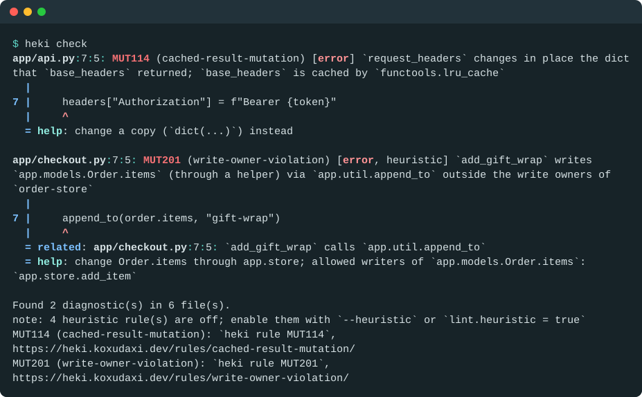

# heki

<p align="center">
  
</p>

🧱 heki (壁, Japanese for "wall") is a static checker for Python, written in Rust. It tracks side
effects and mutations across function calls.

By default, it catches blocking calls in `async` code, database queries in loops, quadratic
loops, and in-place changes to read-only parameters and to `lru_cache` results. You can also add
rules in `pyproject.toml` to restrict which functions may mutate state or reach I/O.



These reports are *exact*: built only from facts heki established, by rules whose every report
on a corpus was checked by hand ([Rule precision](precision.md#certifications)).

<p>
  <a class="md-button md-button--primary" href="getting-started/">Getting Started</a>
  <a class="md-button" href="rules/">Rules</a>
  <a class="md-button" href="configuration/">Configuration</a>
</p>

[](https://pypi.org/project/heki/)
[](https://pypi.org/project/heki/)
[](https://github.com/koxudaxi/heki/actions/workflows/ci.yml)
[](https://github.com/koxudaxi/heki/blob/main/LICENSE)

⚡ Try it in your project's root, without installing: `uvx heki==0.7.0 check`, then follow
[Try it in 5 minutes](#try-it-in-5-minutes)

---

### A blocking call two helpers below an `async def`

```python
# app/users.py
import requests

def fetch_name(user_id: int) -> str:
    return requests.get(f"https://api.example.com/users/{user_id}", timeout=5).text

def load_user(user_id: int) -> dict[str, str]:
    return {"id": str(user_id), "name": fetch_name(user_id)}
```

```python
# app/api.py
from app.users import load_user

async def get_user(user_id: int) -> dict[str, str]:
    return load_user(user_id)
```

```console
$ heki check
app/api.py:5:12: EFF101 (async-blocking-call) [error] `app.users.load_user` always runs the waiting call `requests.get` on the event loop (2 calls down, on every path)
  |
5 |     return load_user(user_id)
  |            ^
  = related: app/api.py:5:12: `get_user` calls `app.users.load_user`
  = related: app/users.py:8:41: `load_user` calls `app.users.fetch_name`
  = related: app/users.py:5:12: `fetch_name` calls `requests.get`
  = help: offload it with `asyncio.to_thread`, or use an async client

Found 1 diagnostic(s) in 2 file(s).
note: 4 heuristic rule(s) are off; enable them with `--heuristic` or `lint.heuristic = true`
EFF101 (async-blocking-call): `heki rule EFF101`, https://heki.koxudaxi.dev/rules/async-blocking-call/
```

### A query one helper below a loop

```python
# app/orders.py
import sqlite3

def customer_name(cursor: sqlite3.Cursor, customer_id: int) -> str:
    cursor.execute("SELECT name FROM customers WHERE id = ?", (customer_id,))
    return str(cursor.fetchone()[0])

def order_summaries(cursor: sqlite3.Cursor, orders: list[tuple[int, int]]) -> list[str]:
    lines: list[str] = []
    for order_id, customer_id in orders:
        lines.append(f"#{order_id} {customer_name(cursor, customer_id)}")
    return lines
```

```console
$ heki check
app/orders.py:11:37: EFF103 (loop-db-query) [warning] every iteration over parameter `orders` sends a database statement: `sqlite3.Cursor.execute` (through `app.orders.customer_name`)
   |
11 |         lines.append(f"#{order_id} {customer_name(cursor, customer_id)}")
   |                                     ^
  = related: app/orders.py:11:37: `order_summaries` calls `app.orders.customer_name`
  = related: app/orders.py:5:5: `customer_name` calls `sqlite3.Cursor.execute`
  = help: batch the queries, or load the data once before the loop

Found 1 diagnostic(s) in 1 file(s).
heki check does not fail on 1 report(s) shown now: warnings, and heuristic reports, which can be wrong about the code and count as warnings; `fail-on = "warning"` in the lint settings makes them fail it.
note: 4 heuristic rule(s) are off; enable them with `--heuristic` or `lint.heuristic = true`
EFF103 (loop-db-query): `heki rule EFF103`, https://heki.koxudaxi.dev/rules/loop-db-query/
```

Ruff, ty, Pyrefly, pyright, and mypy report nothing for either example with their default settings.

### How heki differs

The difference is the model, not reaching across files: type checkers already follow types
across modules. heki models effects and aliases, what code does:

| Tool | Models | heki adds |
| --- | --- | --- |
| Ruff | syntax and style | the effects behind a call: a blocking call, a query, or a write, wherever it happens |
| ty, Pyrefly, pyright, mypy | declared types | in-place changes, through aliases and helpers, to `frozen`, `ReadOnly`, and `Final` fields and to `Sequence` / `Mapping` / `AbstractSet` arguments |
| tach, import-linter | which modules may import which | which functions write or read a field, call a function, or reach I/O; which modules may import which, knowing when each import runs (experimental); planned: these tools' contracts read as heki contracts |

Their stricter settings do not close the gap. The second example above is fully annotated and
passes Ruff's annotation rules (`ANN`), `mypy --strict`, pyright's strict mode, and Pyrefly's
`strict` preset, yet it sends one query per order: the types are right, and what the code does
is slow. heki leaves syntax, style, and types to these tools, and keeps doing so as they grow:
use it next to them.

### Try it in 5 minutes

1. In the project's root, the directory with `pyproject.toml`, run the default rules without
   installing heki: `uvx heki==0.7.0 check`. An exact error, a bug that can be critical like the
   first example above, fails the run (exit code 1). Warnings, like the second, and heuristic
   reports, which can be wrong about the code, are printed and do not fail it (exit code 0)
   unless `--fail-on warning` is given. A note at the end says how many heuristic rules were
   left off; `--heuristic` runs them.

2. Ask what fits the project. [`heki recommend`](recommend.md) (experimental) writes no file,
   and it helps most when the first step finds nothing. On the
   [sample service](https://github.com/koxudaxi/heki/tree/main/tests/sample_service) of heki's
   tests, `heki check` passes, and `heki recommend` says what heki could not see and which
   contract the code already keeps:

    ```console
    $ uvx heki==0.7.0 check
    All checks passed (4 file(s)).
    ...
    hint: `heki recommend` (experimental) lists the rules and contracts that fit this project, and what heki could not see
    $ uvx heki==0.7.0 recommend
    heki recommend (experimental) on .: 4 file(s), 10 function(s)
    ...
    What heki cannot see (no report either way)
      calls of packages heki's catalog does not cover: 1 call(s) of 1 name(s) in 1 package(s)
        name                  calls  async  loops  if it waits     if it sends a query
        stripe.Charge.create      1      1      0  EFF101 1 exact  -
    ...
    Contract candidates
      write-owners  app.models:Order.*  high
        written by 1 function(s), all in app.store (add_item), changed in place; read in 2 other module(s)
    ...
    ```

    heki's catalog does not say what `stripe.Charge.create` does, so heki reports nothing through
    it: if the call waits on the network, `EFF101` would report it in `async def checkout`. And
    only `app.store` writes `Order.items`: the report ends with the keys that declare this as a
    contract.

3. Keep it running. The [pre-commit hook](adoption.md#pre-commit) checks what a commit
   touches (`heki check --touched`), and a CI step runs `uvx heki==0.7.0 check` on the whole
   project. On code with findings today, record them first in a
   [Ratchet baseline](adoption.md#ratchet-baselines), so that only new ones fail:
   `uvx heki==0.7.0 check --baseline heki-baseline.toml --update-baseline`, then
   `baseline = "heki-baseline.toml"` in `[tool.heki]`. The
   [starter recipes](adoption.md#starter-recipes) have these setups as blocks to copy.

!!! warning "Pre-release"

    The exact rules are certified, but heki is still under active development: rules,
    configuration keys, diagnostics, and output formats can change between releases without a
    deprecation period, and each change is listed in the release notes. So pin the version you
    adopt (`heki==0.7.0`, and the hook's `rev`): an upgrade is then a change you review like any
    other. A Ratchet baseline of today's findings, and `--touched` in the hook, keep old findings
    from blocking work. Try it on your code and report what it gets wrong.

### Your conventions, checked instead of reviewed

The checks above need no configuration: `EFF101` and `EFF103` are exact and run by default.
The rules of your own project, which you keep today by review, by AST scripts, or by run-time
guards in tests, and which a coding agent cannot know unless a check tells it, can be added as a
few lines of [configuration](configuration.md).

For example, these lines say that only the functions in `app.store` may change `Order.items`:

```toml
[[tool.heki.write-owners]]
name = "order-store"
targets = ["app.models.Order.items"]
allowed-writers = ["app.store.*"]
```

A function in `app/api.py` that appends to `order.items` through a helper breaks it:

```console
$ heki check
app/api.py:9:5: MUT201 (write-owner-violation) [error, heuristic] `add_gift_wrap` writes `app.models.Order.items` (through a helper) via `app.api._append` outside the write owners of `order-store`
  |
9 |     _append(order.items, "gift-wrap")
  |     ^
  = related: app/api.py:9:5: `add_gift_wrap` calls `app.api._append`
  = help: allowed writers of `app.models.Order.items`: `app.store.add_item`

Found 1 diagnostic(s) in 3 file(s).
heki check does not fail on 1 report(s) shown now: warnings, and heuristic reports, which can be wrong about the code and count as warnings; `fail-on = "warning"` in the lint settings makes them fail it.
```

The report is heuristic: the contract rules are not [certified](precision.md#certifications)
yet, and a `MUT201` report can rest on an alias or a helper's write on one path only. A heuristic
report counts as a warning, so the run passes, as its last line says. To make a broken contract
fail the run and CI, set `fail = true` in its table: the reports of that contract fail the run,
and every other warning and heuristic report stays advisory. Record today's findings in a
[Ratchet baseline](adoption.md#ratchet-baselines) first.

heki follows aliases, helpers, and subclasses, with no decorators and nothing running at run
time. Each kind of rule has its own contract:

| What you want to keep | Contract | Main keys |
| --------------------- | -------- | --------- |
| Only `app.store` changes `Order.items` | `write-owners` | `targets = ["Order.items"]`, `allowed-writers = ["app.store.*"]` |
| Only `app.billing` reads `Order.card_token` | `read-owners` | `targets = ["Order.card_token"]`, `allowed-readers = ["app.billing.*"]` |
| Only `app.admin` calls `app.db.reset` | `call-owners` | `targets = ["app.db.reset"]`, `allowed-callers = ["app.admin.*"]` |
| No caller changes the settings `load_settings` returns to everyone | `readonly-returns` | `producers = ["app.config.load_settings"]`, `deep = true` |
| Every change of `Order.items` is followed by `order_changed()` | `invalidation` | `targets = ["Order.items"]`, `invalidators = ["app.cache.order_changed"]` |
| Code in `app.render` makes no blocking call | `effect-boundaries` | `scopes = ["app.render.*"]`, `forbid = ["blocking"]` |
| `app.domain` imports nothing from `app.web`, even lazily or inside a function | `import-boundaries` (experimental) | `importers = ["app.domain.*"]`, `forbidden-imports = ["app.web", "app.web.*"]` |

See [Contracts](configuration.md#contracts) for every key.

### Architecture walls for teams and coding agents

A rule written in `AGENTS.md` or `CLAUDE.md` is advice an agent can miss. Declared as a contract,
`heki check` enforces it. Keep the contracts in a `heki.toml` that heki reads instead of
`[tool.heki]` in `pyproject.toml`, and give the file an owner:

```toml
# heki.toml
[[write-owners]]
name = "order-store"
targets = ["app.models.Order.items"]
allowed-writers = ["app.store.*"]
message = "change Order.items through app.store"
fail = true   # a report of this contract fails the run
```

```text
# .github/CODEOWNERS
/heki.toml           @your-org/maintainers
/heki-baseline.toml  @your-org/maintainers
```

- The `message` becomes the help of every report of the contract, so an agent reads it as the
  fix: `= help: change Order.items through app.store; allowed writers of ...`.
- With an owner on `heki.toml` and on the baseline, moving a wall is a reviewed change: an agent
  cannot move one to make a report go away.
- A [Stop hook](coding-agents.md#a-stop-hook-for-claude-code) runs `heki check` when Claude
  Code is about to end its turn, and sends a failing report back to it, so the agent keeps
  working until the walls hold.
- [`heki inspect app.api.checkout`](coding-agents.md#what-a-function-does-heki-inspect-experimental)
  (experimental) says what one function reaches, changes, keeps, and returns, with the call
  chains, so an agent does not read its callees to find out.
- Agents get every check as JSON (`--output-format json`), and an
  [Agent Skill](coding-agents.md#agent-skill-experimental) (experimental) teaches them the
  routine after an edit and how to adopt heki in a repository.
- The [language server](lsp.md) checks while you edit, and
  [`heki snapshot`](adoption.md#effect-snapshots-mut103) with `MUT103` reports a function that
  gained an effect, which a diff does not show.

## ✨ Why heki?

Types say what values are; heki checks what code does:

- **Aliases and in-place changes:** which objects a function changes, through any alias, helper,
  or subclass.
- **Contracts:** who may write, read, or call what, and which code may reach I/O.
- **Proven rewrites:** quadratic patterns are rewritten only when the rewrite is proven, not
  guessed.

### What code does, not what types it has

These rules are exact and run by default. Each report shows the chain of calls that leads to it.

| What goes wrong | Rule |
| --- | --- |
| A blocking call that a call in an `async def` always runs, several helpers below | [`EFF101`](rules/async-blocking-call.md) |
| A database statement on every iteration of a loop over data | [`EFF103`](rules/loop-db-query.md) |
| A `Sequence` / `Mapping` / `AbstractSet` argument changed in place by a helper | [`MUT110`](rules/readonly-param-mutation.md) |
| A list, dict, or set that an `lru_cache` / `cache` function returned, changed in place | [`MUT114`](rules/cached-result-mutation.md) |
| A change of a builtin container that is lost because the object is new and nothing holds it (`list(xs).sort()`) | [`MUT119`](rules/change-lost-on-new-object.md) |
| A DataFrame or array concatenated with itself on every loop iteration | [`DATA101`](rules/loop-carried-concat.md) |
| A list rebuilt, or a dict or set merged, on every loop iteration, and a nested-loop join | `OPT101`, `OPT102`, `OPT113` ([fixes](fixes.md)) |

The size-dependent rewrites (`OPT103`, `OPT110`, `OPT111`, `OPT120`, `OPT121`, `OPT130`) are exact
too, but opt-in: the loops they report were rarely large enough to matter
([Rule precision](precision.md#certifications)).

To certify a rule, two reviewers check by hand every exact report it makes on the development
corpus (378 packages and 30.75 million lines, plus packages added for rules with few reports), and
one run on a frozen holdout of 100 packages is checked too. Neither may hold a false claim.
`EFF101` and `EFF103`, the rules of the two examples above, had 287 and 103 reports on the corpus
and 152 and 122 on the holdout, none false.
[Rule precision](precision.md#certifications) lists every certified rule.

*Heuristic* reports can be wrong about the code. They are opt-in (`heki check --heuristic`), and
every output labels them.

The other rules are heuristic or opt-in, and the [contract](configuration.md#contracts) rules run
once you declare a contract: see [Rules](rules/index.md) and [Rule precision](precision.md).

### Fast, quiet, and easy to adopt

- A 100,000-line project is checked in a few seconds.
- [`heki recommend`](recommend.md) (experimental) prints advice on the project's configuration,
  with the keys to add to `[tool.heki]`.
- A report needs evidence: when heki cannot tell, [it stays quiet](scope.md#when-heki-cannot-tell).
- Configuration, suppression comments, and output formats follow Ruff, and a [baseline](adoption.md#ratchet-baselines) fails CI
  only on new findings.

## 🔓 What Python leaves open

| What Python leaves open | What other languages enforce | What heki checks |
| --- | --- | --- |
| Any code can change any object it reaches | ownership and borrowing (Rust), `const` / `readonly` | read-only parameters, fields, and views changed through helpers (`MUT110`, `MUT108`, `MUT120`); `write-owners` / `read-owners` contracts (`MUT201`, `MUT203`) |
| A signature does not say what a function does | effect types, `IO` in the type (Haskell) | blocking calls reached from `async def`, and clients and queries in loops (`EFF101`–`EFF103`); `effect-boundaries` (`EFF201`); effect snapshots (`MUT103`) |
| Shared mutable objects hide changes | value semantics, immutability by default | stale cached properties and hashes (`MUT101`, `MUT107`); changed shared return values (`MUT114`, `MUT202`); writes an `invalidation` contract must announce (`MUT208`) |
| Dynamic dispatch blocks optimizations | static types let a compiler prove a rewrite | quadratic patterns (`OPT`), rewritten only when proven under CPython's semantics |

## 🔧 Rewrites proven under CPython's semantics

The `OPT` rules find quadratic list, dict, set, bytes, and queue patterns. `heki check --fix`
rewrites one only when it proves that the program behaves the same: it trusts no type
annotation, any other reference to the object blocks an in-place update, evaluation order and
exceptions are kept, and builtins count only while the module does not rebind them. When a proof
fails, the report names the missing obligation instead of offering a fix.

`--fix` alone applies the rewrites that are faster for every input (`OPT101`, `OPT102`).
`--include-size-dependent` adds those of the size-dependent opt-in rules, such as a
`collections.deque` for `list.pop(0)` (`OPT120`). [Fixes and safety](fixes.md) shows each
rewrite and what it must prove.

## 👉 Next steps

- 🎯 See what heki [covers and does not cover](scope.md).
- 📦 [Install heki](installation.md) and 🚀 [run it on a project](getting-started.md).
- ⚙️ [Configure](configuration.md) rule selection, contracts, and the Python version.
- 📏 Browse the [53 rules](rules/index.md), and see [how precise each one is](precision.md).
- 🔧 Read how [fixes are proven safe](fixes.md).
- 🪜 [Adopt it gradually](adoption.md) with a Ratchet baseline in CI.
- 🖥️ Use it from [your editor](lsp.md) or 🤖 [a coding agent](coding-agents.md).

## 📛 Name

*heki* is 壁, "wall", in its Sino-Japanese (*on*) reading, the one used in compounds such as
防火壁 (*bōkaheki*, "firewall"). On its own the character is usually read *kabe*.
