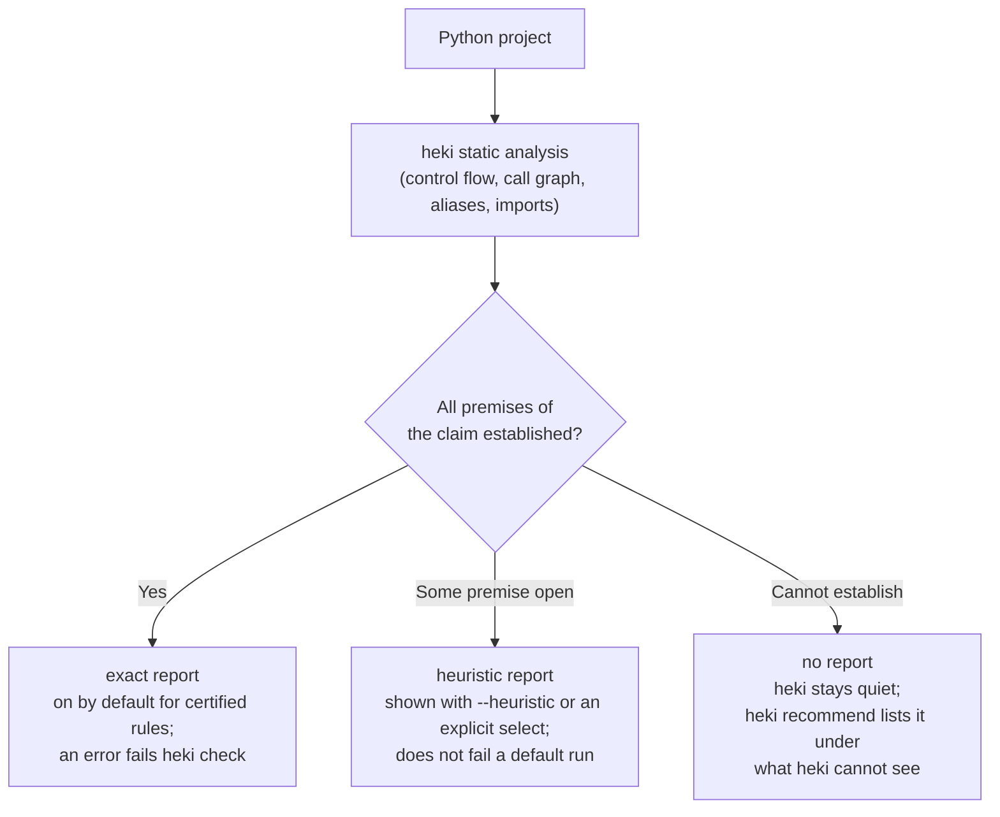

# Rule Precision

## At a glance

heki reports a claim only when it can back it. What it can back decides the tier of a report, and
what it cannot decide gets no report.



The same function-and-rule pair in three shapes. Each output below is from `heki check`.

**A, exact.** `handler` always reaches `requests.get` through `fetch`:

```python
async def handler(url):
    return fetch(url)  # fetch always calls requests.get(url)
```

```console
$ heki check .
app.py:9:12: EFF101 (async-blocking-call) [error] `app.fetch` always runs the waiting call `requests.get` on the event loop (1 call down, on every path)
Found 1 diagnostic(s) in 1 file(s).
$ echo $?
1
```

**B, heuristic.** `fetch` calls `requests.get` only `if refresh:`, so the premise "Every return"
(the function has made the next call on every path on which it returns) is open:

```python
def fetch(url, refresh):
    if refresh:
        return requests.get(url)
    return None
```

```console
$ heki check .
All checks passed (1 file(s)).
note: 5 heuristic rule(s) are off and 1 heuristic report(s) are not shown; enable them with `--heuristic` or `lint.heuristic = true`
$ heki check --heuristic .
app.py:11:12: EFF101 (async-blocking-call) [error, heuristic] `handler` reaches the blocking call `requests.get` on the event loop
Found 1 diagnostic(s) in 1 file(s).
$ echo $?
0
```

**C, no report.** `callback` is a parameter without an annotation, so heki does not follow the call:

```python
async def handler(url, callback):
    return callback(url)
```

```console
$ heki check --heuristic .
All checks passed (1 file(s)).
$ heki recommend .
  calls heki does not resolve: 1 call(s) in 1 function(s)
    function     calls  async  loops  why
    app.handler      1      1      0  parameter `callback` has no annotation (callback)
```

| Stage | Example | Default `heki check` | With `--heuristic` |
| ----- | ------- | -------------------- | ------------------ |
| exact | A | reported, exit code 1 | reported, exit code 1 |
| heuristic | B | not shown, exit code 0 | reported as `heuristic`, exit code 0 |
| no report | C | silent, exit code 0 | silent, exit code 0 |

The rest of this page defines the two tiers and says how a rule becomes exact.

Every heki report is **exact** or **heuristic**:

- An exact report is built only from facts heki established. Its claim, what its message states
  about the code, is a set of premises (its rule page lists them under "What a report states"),
  and each premise was established: where heki cannot tell, it does not report. A false exact
  report is a bug.
- A heuristic report states the same kind of claim, but some premise may be open: heki reported
  without ruling it out. It can be wrong about the code, and every output labels it `heuristic`.

A rule is exact once it is certified (below), and heuristic until then. An exact rule's report
is exact when it established every premise of the rule's exact claim, and heuristic when one is
open: an `OPT` rewrite heki could not prove safe, a size-dependent `OPT` rewrite over a loop whose
trip count the data does not decide (the code fixes or caps it, or the loop's items are not a
parameter, the rows of a query, the lines of a file, or the entries of a directory), an `OPT113`
join whose rule page premises do not all hold, or
an `EFF101`, `EFF102`, `EFF103`, `EFF105`, `EFF109`, `EFF116`, `DATA101`, `MUT110`, `MUT114`, or
`MUT119` report whose rule page premises are not all established. Only exact reports are shown by
default, and only those of the exact rules that are not opt-in.

- A heuristic rule runs when `select` or `extend-select` names its code or name. With
  `lint.heuristic = true` (`--heuristic`), the heuristic rules that are not opt-in also run by
  default and for their prefixes and `ALL`.
- The heuristic reports of an exact rule are shown under the same conditions: with
  `lint.heuristic = true`, or when its code or name is selected.
- A contract rule runs when its contract is declared, whatever its certainty.
- A run of `full` or `concise` output that leaves heuristic rules off, or heuristic reports out,
  ends with a note saying how many.
- Only an exact report fails a run by default: a heuristic report counts as a warning for
  [`fail-on`](configuration.md#rule-selection-toolhekilint), whatever its rule's severity, and
  fails the run only with `fail-on = "warning"`, or when its contract table sets `fail = true`. A
  false heuristic report never stops a CI or a hook that keeps the default.

See [Rule selection](configuration.md#rule-selection-toolhekilint). `EFF101`, `EFF102`,
`EFF103`, `EFF105`, `EFF109`, `EFF116`, `DATA101`, `MUT101`, `MUT110`, `MUT111`, `MUT114`, `MUT119`, the proven tier of the eight `OPT`
rewrite rules, and the exact tier of `OPT113` are exact (certified below); the other rules are
heuristic. `MUT101`, `MUT111`, and the six size-dependent `OPT` rules (`OPT103`, `OPT110`,
`OPT111`, `OPT120`, `OPT121`, `OPT130`) are exact and opt-in, for their share of real harm
(below); `EFF105` is exact and opt-in, as local file I/O is usually fast.

## What a report states

A report states what its message says about the code, in the terms its rule page defines. It is
wrong when that statement is false. Whether the code does harm is a separate question, and so is
whether a rewrite of it would be valid:

- A query in a loop over three items has the shape the rule reports; the harm is small.
- A write the author meant, or a memo heki does not recognize, still changes the object.
- A rewrite that a fact heki cannot prove blocks is a question of [fix safety](fixes.md).

The premises the rules use:

- **Resolves**: a call is to the function shown, through the calls heki resolves ([How a call is
  resolved](scope.md#how-a-call-is-resolved)). Through a method call, every implementation the
  call can reach counts. A receiver typed by a `Protocol` is not resolved for an exact report:
  its implementers are never a complete set.
- **Reaches on every path**: whenever the reported call returns, the effect has run: each
  function on the chain reaches the next call on every path on which it returns. The claim is
  anchored at the reported call, so a branch around that call in its own function does not
  matter.
- **On every iteration**: the statement runs on every iteration of the loop that completes.
  It does not when every way on from it leaves the loop, or when a first-iteration flag, a flag
  set once, or a lazy initialization the loop tests guards it.
- **Steps through an input**: the loop iterates a named input, such as a parameter, an
  attribute of one, the rows of a query, or the lines of a file.
- **Data-sized** (heuristic reports only): the code does not fix the size or the number of
  iterations at 16 or fewer. heki counts a size it cannot bound as data-sized, so this premise
  is open whenever no bound is found. An exact report never claims a size: a bound of 16 or
  fewer only removes reports, and a larger fixed bound is no evidence either way.

Each exact rule's premises are rows of one table, `crates/heki_rules/src/premises.rs`: what each
states and where heki decides it, the one place every rule reading it goes through. A rule page
lists its claim's premises under "What a report states" by those names (the documentation build
checks it), `heki rule --output-format json` prints them, and a report is exact only when every
premise of its rule's row is established.

A heuristic report of an exact claim can also say which premises of its row it left open, each
with a cause from a closed list kept next to the premise in the same table (what the cause states,
and what closes it: an annotation, a change of the code, heki's catalog, or nothing today). The
causes come from the steps of the decision that made the report heuristic, each premise evaluated
on its own along the reported chain and loop, so they cannot disagree with its tier.
[`heki recommend`](recommend.md) counts the heuristic reports by these causes; no output format of
`heki check` and nothing in the language server shows them. The heuristic reports of `EFF101`,
`EFF103`, the eight `OPT` rewrite rules, `OPT113`, `DATA101`, `MUT110`, and `MUT114` record them. A proven size-dependent `OPT` rewrite, or an `OPT113` join whose premises all hold, over
a loop the data does not size is heuristic for a condition of the exact tier that is no premise,
"Trip count open" (the claim holds, but the change pays off only over a loop the data sizes): the
code fixes the loop at more than 16 trips or caps it, or, for a rewrite, the loop's items are not
the data's as `EFF103`'s Origin establishes them (a loop over an attribute of `self`, a project
function's result, `range` of a configured number, or a `while` loop runs as many times as the
program has parts). The report records that condition, with its cause, in the same list as the
premises it left open, if any.

An exact report's message states its claim and the witnesses of its premises, nothing else: no
cost estimate such as "(N+1)", and no advice (that goes into the help).

Exact claims hold in every run consistent with seven assumptions
([ARCHITECTURE.md, section 3.4](https://github.com/koxudaxi/heki/blob/main/ARCHITECTURE.md)):

- **R1**: the functions and classes on a call chain are not replaced at run time. A special
  method bound on a class after its body (`__setattr__`, `__delattr__`, `__getattribute__`,
  `__getattr__`, a copy hook) is bound under its own name: a store under a constant name (a
  string literal, or a module or class name bound once to one), or under a name the storing
  function builds with constant text that can still spell it, may bind it, and a store under a
  name of unknown value (a parameter, a loop variable over `dir()`, `vars()`, or a mapping's keys,
  a value read from data, a module name bound to a built string) is taken to bind none. This
  gives up `setattr(cls, name, hook)` binding `__setattr__` through such a `name`. Code heki
  does not read is taken to bind none either: a class decorator outside the project, and a call
  or a closure the class is handed to, bind on it only what the stores heki reads bind.
- **R2**: a value annotated `C` is an instance of `C` or of a project subclass. A premise that
  goes through a method call holds only when every implementation in such a subclass has it.
  A value annotated with a nominal container ABC (`Sequence`, `Mapping`, `Set`, and their mutable
  ABCs) is one of its family's builtins or another library class implementing it, taken to run
  what the builtin runs, or a project class implementing it (deriving from it or from a class of
  its family, or registered with it); a `register` heki cannot resolve or a `__subclasshook__`
  leaves such values open, as are those of a structural ABC (`Iterable`) or a protocol.
  Rewrites never rely on annotations.
- **R3**: the ecosystem catalog describes the library, an effect with its condition.
- **R4**: imports resolve as configured.
- **R5**: the checked files are the project.
- **R6**: a library call's argument is a value it waits on (a nonzero sleep, a host name to look
  up) unless heki establishes otherwise, and so are the arguments that opened the connection it
  runs on (a SQLAlchemy engine or another DB-API connection opened from a URL heki does not
  know waits). `sqlite3.connect` is the one exception, as its in-memory form is common: a SQLite
  connection waits only when heki establishes that it was opened on a file. In the same way, an
  argument selects none of the cases of its call's catalog entry unless heki establishes
  otherwise, so the call has the entry's own effects: `open(name)` opens a path, not a file
  descriptor, and `openai.OpenAI(http_client=client)` makes a client of its own.
- **R7**: no asynchronous or resource-exhaustion exception (`MemoryError`, `KeyboardInterrupt`, a
  signal) is raised. Under it, loading a local, a module name bound once, a builtin, or a member
  of an imported module, and building a `list` or `tuple` display, do not raise; other attribute
  loads, subscripts, `set` and `dict` displays, calls, awaits, and operators may.

"A branch heki cannot decide can go both ways" is not an assumption: a report that needs it is
heuristic. Neither is a context manager heki does not resolve: it may suppress exceptions, so an
exact report claims nothing that runs in its body after a statement that may raise.

Each checked report gets one class:

| Class | Meaning |
| ----- | ------- |
| C (confirmed) | The problem is real and observable from the code. |
| P (plausible) | The report is right, and the code does harm at realistic sizes. |
| B (benign) | The report is right, but the code is deliberate or harmless at realistic sizes. |
| F (false) | The report is wrong about the code. |

"Right about the code" is C, P, and B together; "real harm" is C and P. Real harm is published
for each rule. It decides only whether an exact rule runs by default: it does when its share of
real harm is worth the line it prints, and is opt-in otherwise. For the `OPT` rules the share is
that of their exact reports in their certification runs ([Harm of the exact
reports](#harm-of-the-exact-reports)):

- The six size-dependent rules are opt-in: their rewrites are proven, but of their exact reports
  only 2 of the 203 the census classified, and 1 of the 233 of the holdout run, were of real
  harm.
- `OPT101` and `OPT102` run by default although none of their exact reports was: their rewrite
  is faster for every input and the default `heki check --fix` applies it
  ([Fixes and Safety](fixes.md)), so a report is a fix, not only a line to read.
- `OPT113` runs by default on its own share: 2 of its 8 census reports, and none of its 6
  holdout reports.
- A rule with fewer than 10 exact reports in its certification runs by default on the real bugs
  it found instead: [Rare failures](#rare-failures).

## How a rule becomes exact

A rule is certified exact when all four hold:

1. **Premise stripping**: for each premise of its claim, the tests hold a counterexample that
   the rule reports once that premise is taken as established, and does not report otherwise.
2. **Census**: every report the rule has on the development corpus (the 378 packages of Stage
   0-A, 30.75 million lines, and the packages added for the rules with few reports) is checked
   by hand by two reviewers. A false claim needs a minimal reproduction, and is fixed as a
   defect of a premise's fact, never by a list of exclusions.
3. **Holdout**: one run on a frozen holdout corpus of 100 packages, never looked at while the
   rule was designed or fixed, finds no false claim outside a violation of R1-R7.
4. **Run-time oracle**: the claimed events (the call that runs, the statement executed on each
   iteration) happen where the code ran, checked with `sys.monitoring` on the differential test
   suite and on datamodel-code-generator and, for a rule whose sites those do not have, on
   programs its premise table generates: each base program fails as claimed, and no program with
   a premise stripped does.

Every release then runs the corpus with the release candidate and checks every report it adds
or changes in an exact rule. A false claim found later is a bug: it is fixed before the next
release, or the rule becomes heuristic in that release and needs a new certification.

## Rare failures

Some rules report a failure that mature code has already fixed: an import that raises, a lock
that waits for itself, a function body that never runs. heki reports them where the code is
written, in the editor and in hooks, so the corpus has few of them, and a share of real harm
cannot be read from a handful of reports. Such a rule is certified as any other, and runs by
default when all of these hold:

1. Its consequence is `Bug`, and its claim is a failure a run shows: an exception, a wait that
   never ends, a body that does not run, or a test that gives the opposite answer.
2. Its census and its holdout run have fewer than 10 exact reports together, and no false claim.
   A census or a holdout run without a report counts; packages added for the rule are not
   required.
3. The run-time oracle shows both sides on programs its premise table generates: every base
   program reports and fails as claimed where it runs, and no program with one premise stripped
   reports or fails.
4. It found at least two real bugs, in two projects: exact reports that two reviewers class as
   confirmed, at the parent commit of a merged pull request that fixes the failure (the report
   is gone at the fix), or in the young repositories of the development corpus.

A false claim found later demotes the rule as for any exact rule. A rule that reaches 10 exact
reports is judged on its share of real harm. Below 10, one report moves the share by more than 10
points, so the 10 % bar decides nothing.

The certifications table records the real bugs of such a rule, and `build_docs.py` fails when a
rule in the default set with fewer than 10 exact reports has none recorded. It exempts the rules
of consequence `MinorBug` and the rules certified before this section existed (`OPT101`,
`OPT102`, `OPT103`, `OPT110`, `OPT111`, `OPT120`, `OPT121`, `OPT130`, `OPT113`, `EFF101`,
`EFF103`, `DATA101`, `MUT110`, `MUT114`, `MUT101`, `MUT111`, `MUT119`); a rule certified after it
is not exempt.

## Certifications

A certified rule has a row here: the release that certified it, and the reports of its census
and of its holdout run with the false claims among them. The census of the proven `OPT` tier
checked by hand every exact report on the Stage 0-A corpus with the build of 2026-11-21 (one
report, whose rewrite needed the set-order obligation, left the tier); the holdout run checked
every exact report of one run on the 100 packages of the frozen holdout corpus. `OPT113`'s
census reports are those of its exact tier with the plain-key premise, all among the reports
the census of the earlier tier checked by hand. The census of `EFF101` counts its boundaries
before reports reaching one waiting call are folded together.

<!-- Generated by scripts/build_docs.py from crates/heki_rules/src/precision.rs: certifications. -->

| Rule | Certified | Census: reports / false | Holdout: reports / false | Real bugs |
| ---- | --------- | ----------------------: | -----------------------: | --------: |
| `OPT101` | 0.2.0 | 7 / 0 | 2 / 0 | - |
| `OPT102` | 0.2.0 | 1 / 0 | 0 / 0 | - |
| `OPT103` | 0.2.0 | 128 / 0 | 188 / 0 | - |
| `OPT110` | 0.2.0 | 8 / 0 | 0 / 0 | - |
| `OPT111` | 0.2.0 | 7 / 0 | 7 / 0 | - |
| `OPT120` | 0.2.0 | 70 / 0 | 33 / 0 | - |
| `OPT121` | 0.2.0 | 12 / 0 | 5 / 0 | - |
| `OPT130` | 0.2.0 | 1 / 0 | 0 / 0 | - |
| `OPT113` | 0.2.0 | 8 / 0 | 6 / 0 | - |
| `EFF101` | 0.2.0 | 287 / 0 | 152 / 0 | - |
| `EFF103` | 0.2.0 | 103 / 0 | 122 / 0 | - |
| `DATA101` | 0.2.0 | 6 / 0 | 0 / 0 | - |
| `MUT110` | 0.2.0 | 5 / 0 | 2 / 0 | - |
| `MUT114` | 0.2.0 | 5 / 0 | 5 / 0 | - |
| `MUT101` | 0.2.4 (experimental) | 26 / 0 | 1 / 0 | - |
| `MUT111` | 0.2.4 (experimental) | 60 / 0 | 2 / 0 | - |
| `MUT119` | 0.2.5 | 23 / 0 | 2 / 0 | - |
| `EFF109` | 0.10.0 | 6 / 0 | 1 / 0 | 7 |
| `EFF116` | 0.10.0 | 10 / 0 | 0 / 0 | - |
| `EFF105` | 0.12.0 | 1289 / 0 | 1514 / 0 | - |
| `EFF102` | 0.12.0 | 54 / 0 | 30 / 0 | - |

<!-- End of the generated certifications. -->

The exact tier of the size-dependent rewrites has since asked that the data decide the loop's trip
count, which keeps a subset of the reports their census and holdout run checked.

## Harm of the exact reports

The table below is why the size-dependent `OPT` rewrites are opt-in: almost none of their exact
reports were of real harm. The bug rules (`EFF`, `MUT`) are a different kind. A report of one names
a defect, and [Measurements](#measurements) gives the real-harm share of each in its own row.

The certification runs of the `OPT` rules classed the harm of their exact reports. The census
reused the classes of an earlier pre-check, which classed a sample, so some census reports have
none. The census of `EFF105` classed each site once, so the reports that share a site with
another have none.

<!-- Generated by scripts/build_docs.py from crates/heki_rules/src/precision.rs: harm. -->

| Rule | Census: C / P / B / not classified | Holdout: C / P / B / not classified |
| ---- | ---------------------------------- | ----------------------------------- |
| `OPT101` | 0 / 0 / 6 / 1 | 0 / 0 / 2 / 0 |
| `OPT102` | 0 / 0 / 1 / 0 | 0 / 0 / 0 / 0 |
| `OPT103` | 0 / 0 / 124 / 4 | 0 / 0 / 188 / 0 |
| `OPT110` | 0 / 0 / 7 / 1 | 0 / 0 / 0 / 0 |
| `OPT111` | 0 / 0 / 7 / 0 | 0 / 0 / 7 / 0 |
| `OPT120` | 0 / 2 / 52 / 16 | 0 / 1 / 32 / 0 |
| `OPT121` | 0 / 0 / 10 / 2 | 0 / 0 / 5 / 0 |
| `OPT130` | 0 / 0 / 1 / 0 | 0 / 0 / 0 / 0 |
| `OPT113` | 0 / 2 / 6 / 0 | 0 / 0 / 6 / 0 |
| `EFF109` | 3 / 3 / 0 / 0 | 1 / 0 / 0 / 0 |
| `EFF116` | 1 / 4 / 5 / 0 | 0 / 0 / 0 / 0 |
| `EFF105` | 43 / 419 / 809 / 18 | 48 / 493 / 973 / 0 |
| `EFF102` | 1 / 14 / 39 / 0 | 5 / 16 / 9 / 0 |

<!-- End of the generated harm. -->

A run of the 0.3.0 build on the frozen holdout corpus (2026-11-24), with the eight rewrite rules
and `OPT113` selected by code, has 134 exact reports. Each is a report the certification's holdout
run checked by hand, and each is benign: the tier that asks the data to decide the trip count
left out the one plausible report. 108 of the 122 `OPT103` reports are one function body, copied
across one vendored library.

| Rule | Exact reports | C / P / B |
| ---- | ------------: | --------- |
| `OPT101` | 2 | 0 / 0 / 2 |
| `OPT102` | 0 | - |
| `OPT103` | 122 | 0 / 0 / 122 |
| `OPT110` | 0 | - |
| `OPT111` | 4 | 0 / 0 / 4 |
| `OPT120` | 0 | - |
| `OPT121` | 0 | - |
| `OPT130` | 0 | - |
| `OPT113` | 6 | 0 / 0 / 6 |

## Measurements

Round 3 sampled up to 50 reports per rule on the Stage 0-A corpus, with the build of 2026-11-21.
These are measurements of the rules as they were then, all heuristic, not certifications;
the Certainty column gives each rule's certainty now. Its reviewers also counted as
wrong a bound past 16 that the code states and an exclusion a rule page documents but heki does
not recognize; under the terms above those reports are right, so these figures are lower
bounds. For `OPT101` and `OPT102` the table keeps the reviewers' verdicts: four of their samples
loop a fixed 4 times, which is not data-sized.

<!-- Generated by scripts/build_docs.py from crates/heki_rules/src/precision.rs: measurements. -->

| Rule | Certainty | Measured | Sample | C / P / B / F | Right about the code | 95% interval | Real harm |
| ---- | --------- | -------- | -----: | ------------- | -------------------: | ------------ | --------: |
| `EFF101` | exact | round 3, 2026-11-21 | 50 | 3 / 13 / 25 / 9 | 82% | 69-90% | 32% |
| `EFF102` | exact | round 3, 2026-11-21 | 50 | 0 / 2 / 25 / 23 | 54% | 40-67% | 4% |
| `EFF103` | exact | round 3, 2026-11-21 | 50 | 0 / 8 / 29 / 13 | 74% | 60-84% | 16% |
| `DATA101` | exact | round 3, 2026-11-21 | 28 | 0 / 3 / 17 / 8 | 71% | 53-85% | 11% |
| `MUT107` | heuristic | round 3, 2026-11-21 | 50 | 1 / 1 / 37 / 11 | 78% | 65-87% | 4% |
| `MUT110` | exact | round 3, 2026-11-21 | 4 | 0 / 0 / 4 / 0 | 100% | 51-100% | 0% |
| `MUT202` | heuristic | round 3, 2026-11-21 | 20 | 2 / 1 / 11 / 6 | 70% | 48-85% | 15% |
| `OPT101` | exact | round 3, 2026-11-21 | 9 | 0 / 0 / 7 / 2 | 78% | 45-94% | 0% |
| `OPT102` | exact | round 3, 2026-11-21 | 6 | 0 / 1 / 3 / 2 | 67% | 30-90% | 17% |
| `OPT103` | exact | round 3, 2026-11-21 | 50 | 0 / 2 / 44 / 4 | 92% | 81-97% | 4% |
| `OPT110` | exact | round 3, 2026-11-21 | 50 | 0 / 3 / 36 / 11 | 78% | 65-87% | 6% |
| `OPT111` | exact | round 3, 2026-11-21 | 50 | 0 / 2 / 42 / 6 | 88% | 76-94% | 4% |
| `OPT112` | heuristic | round 3, 2026-11-21 | 50 | 0 / 2 / 43 / 5 | 90% | 79-96% | 4% |
| `OPT113` | exact | round 3, 2026-11-21 | 50 | 0 / 11 / 35 / 4 | 92% | 81-97% | 22% |
| `OPT120` | exact | round 3, 2026-11-21 | 50 | 0 / 2 / 45 / 3 | 94% | 84-98% | 4% |
| `OPT121` | exact | round 3, 2026-11-21 | 50 | 0 / 1 / 41 / 8 | 84% | 71-92% | 2% |
| `OPT130` | exact | round 3, 2026-11-21 | 30 | 0 / 2 / 27 / 1 | 97% | 83-99% | 7% |

<!-- End of the generated measurements. -->

The other rules (the contract rules and the opt-in rules) have not been measured on this
protocol yet.
